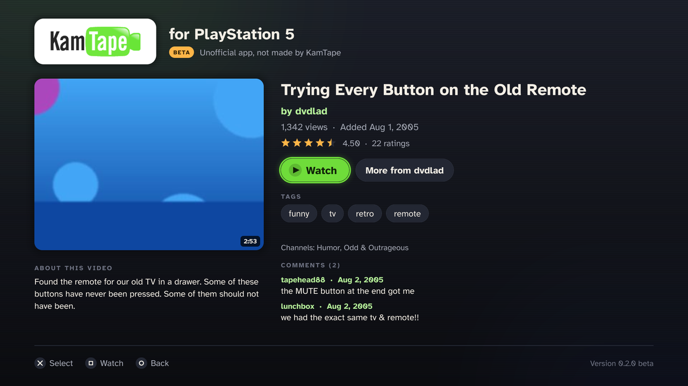
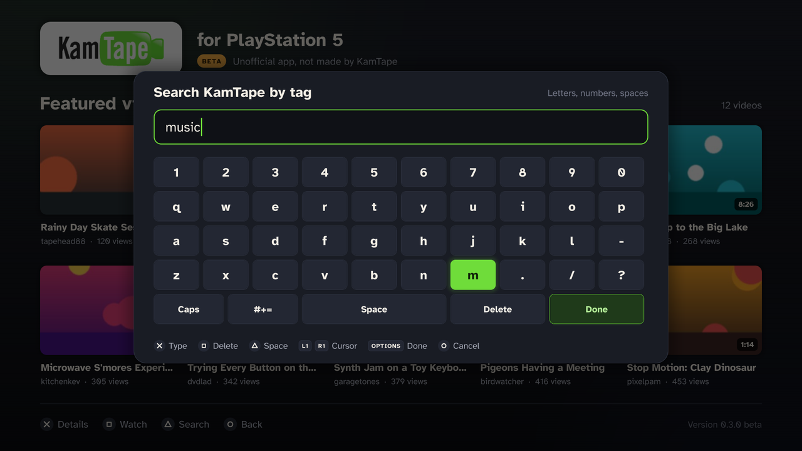
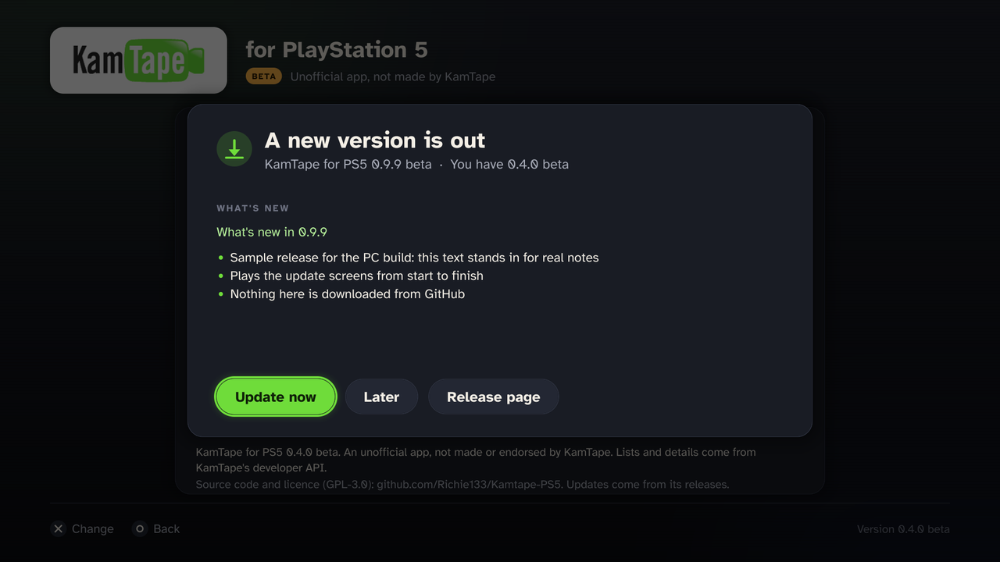

# KamTape for PS5

A native PS5 homebrew app (PPSA52005) for [KamTape](https://www.kamtape.com/), the
retro video site in the style of 2007. Browse featured videos and search by tag on
the TV with thumbnails, ratings and comments, through KamTape's developer API, and
watch in the PS5's browser. **[KamTape XL](https://www.kamtape.com/xl/)**, KamTape's
TV interface, is one button away.

This is an unofficial app. It is not made or endorsed by KamTape.

> **Status: beta.** It builds into a signed app folder, and the whole app runs on a PC
> against made-up sample data (pictures below). **It hasn't been run on a real PS5
> yet**, so the first runs on hardware may need fixes. Please open an issue if
> something goes wrong.


## What it does

- **KamTape XL** opens in the PS5 browser when the app starts (you can turn that
  off), or with ✕ on the big tile.
- **Featured videos**: KamTape's featured list as a grid of thumbnails, with each
  video's length, author and views.
- **Search by tag** (or △ almost anywhere): type a tag on the KamTape keyboard.
  More results load as you scroll, and your last five searches are one press away.
- **Video details**: the picture, description, rating, upload date, tags, channels
  and the first comments. From there: **Watch** opens the video's page in the
  browser, **More from** lists the author's videos, and each tag starts a search.
  □ watches straight from a list too.
- **Go to a page**: any KamTape address, such as `kamtape.com/xl/` or a video link.
  Only KamTape pages open here. The last five stay under **Recent pages**.
- **The KamTape keyboard**: the app's own on-screen keyboard, made for the
  controller, with a text cursor and your recent searches or pages above the keys.
  A **USB keyboard** plugged into the PS5 types into it too, and moves around the
  app with the arrow keys, Enter and Escape; typing a letter on the home screen
  starts a search. Prefer the PS5's own keyboard? Switch it in Settings.
- **Updates from GitHub**: when a new release is out, the app says so and installs
  it itself: it downloads `PPSA52005.zip` from this repository's releases, checks
  it, and restarts into the new version. Needs a payload loader on port 9021
  (etaHEN, or kstuff with elfldr), as most homebrew setups have.
- **Settings** (or OPTIONS): open XL at start, which keyboard, the USB keyboard,
  interface sound volume, clear recent pages and searches, check for updates.

Close the browser to come back to the app. In the browser, move the pointer with the
left stick and press ✕ to click.









## What you need

- A PS5 that runs homebrew apps (etaHEN, or kstuff with a homebrew launcher such as
  ShadowMountPlus).
- An internet connection.

## Install

1. Unzip `PPSA52005.zip` from the [latest release](https://github.com/Richie133/Kamtape-PS5/releases)
   and copy the `PPSA52005` folder to `/data/homebrew/` on the console (FTP). If you
   use a homebrew store such as ProsperoStore, install it from there instead.
2. Open **KamTape for PS5** from the home screen.

## Controls

| | Controller |
|---|---|
| Move | D-pad or left stick |
| Open, details | ✕ |
| Watch in the browser | □ |
| Search by tag | △ |
| Settings | OPTIONS |
| Back | ○ |

On the KamTape keyboard:

| | Controller | USB keyboard |
|---|---|---|
| Type the focused key | ✕ | any key |
| Delete | □ | Backspace, Delete |
| Space (`/` on Go to a page) | △ | Space |
| Move the cursor | L1, R1 (L2: to the start) | ←, →, Home, End |
| Caps | L3 | Shift |
| Done | OPTIONS or R2 | Enter |
| Cancel | ○ | Escape |

## How it works

The app is a native title (`eboot.bin`, `sce_sys/`) with its own OpenGL interface,
built on the same native-app tooling as
[Flashpoint PS5](https://github.com/Richie133/flashpointps5).

- **The KamTape API.** Lists and details come from KamTape's developer API
  (`kamtape.videos.list_featured`, `list_by_tag`, `list_by_user`, `get_details`),
  which follows YouTube's 2005 REST API: GET requests to
  `http://www.kamtape.com/api2_rest` with `method`, `dev_id` and the method's
  parameters, answered in XML. The endpoint and the developer ID are in
  [`src/kt/config.hpp`](src/kt/config.hpp). Requests and thumbnails go through
  libcurl and OpenSSL ([PacBrew](https://github.com/ps5-payload-dev/pacbrew-repo))
  with the boilerplate's console shim (`src/platform/ps5/console_curl.c`), on
  background threads.
- **Watching** opens the video's page in the PS5's own web browser
  (`sceSystemServiceLaunchWebBrowser`); the app doesn't play video itself.
- **Text** comes from the app's own keyboard (`src/kt/osk.cpp`), or from the system
  keyboard (`libSceImeDialog`) when Settings asks for it. A USB keyboard is read
  through `libSceKeyboard`, loaded by its sysmodule ID when the app starts, so a
  console without it still runs the app; if starting it ever crashes the app, the
  next start turns it off and says so. Settings are saved in the title's own
  storage (`/download0/kamtape/settings.json`).

### Updates

About four seconds after it starts, the app asks GitHub for this repository's
releases (`api.github.com/repos/Richie133/Kamtape-PS5/releases`) and looks for
one with a higher `contentVersion` than its own. A release qualifies when its
notes carry the two lines the release workflow writes,

    `PPSA52005.zip` sha256: `<sha256>`
    contentVersion: `01.000.004`

and `PPSA52005.zip` is attached (GitHub's own digest of the file is preferred to
the line in the notes). Older releases, made before the app could update itself,
are skipped. If one is newer, a dialog shows its notes; the badge on Settings and
**Settings ▸ Updates** keep it there after **Later**.

**Update now** hands the release to the self-update kit of the PS5 Native App
Boilerplate (`src/third_party/update_check/self_update.*`, as ProsperoRadio and
ProsperoEden carry it). The app sends `self-updater.elf`
(`third_party/self_update_helper`) to the console's payload loader on loopback port
9021, downloads the zip from github.com and streams it to the helper. Both check
the size and SHA-256; the helper unpacks it next to the installed folder and
checks that it is PPSA52005 at the version announced. The app then closes, and the
helper puts the new files in place and posts a notification. Until that moment,
Cancel, a failure or a lost connection leaves the installed app untouched. Apps
installed as an image (not a folder) are refused, and with no payload loader the
dialog says so and offers the release page.

## Building

On Linux or WSL with clang-18, lld, Python 3 and ninja:

```sh
make             # dist/PPSA52005/ and dist/PPSA52005.zip
make test        # the PC tests (addresses, the keyboard's text field, the XML reader, the API
                 # answers, reading releases) and a fuzz run of the parsers (SANITIZE=1: under ASan/UBSan)
make snapshots   # the app on a PC with the sample data in host/fixtures, pictures in build/snapshots
                 # (the update screens play against a stand-in helper; SANITIZE=1 works here too)
make help        # everything else
```

The first build downloads the pinned [PS5 Payload SDK](https://github.com/ps5-payload-dev/sdk),
[ps5-opengl](https://github.com/darkxex/ps5-opengl) and the PacBrew ports (libcurl,
OpenSSL) into `.deps/` and checks their checksums.

The PC build never touches the network: `host/http_host.cpp` answers from
`host/fixtures/`, invented videos in the API's layout drawn by
`host/fixtures/make_fixtures.py`.

### Releases

Pushing a tag such as `v0.2.0-beta`, or running the **Build** workflow with a
release tag, builds the app on GitHub Actions and publishes `PPSA52005.zip` on a
release for that tag (a pre-release when the tag has `alpha`, `beta` or `rc` in
it), with its sha256 and contentVersion in the notes, which is what the app's
updater reads. Raise `contentVersion` in `sce_sys/param.json` before every
release: that's how installed copies know there is something newer.

## Licence

GPL-3.0-or-later; see `LICENSE` and `THIRD_PARTY_NOTICES.md`. The KamTape name and logo
belong to KamTape.
