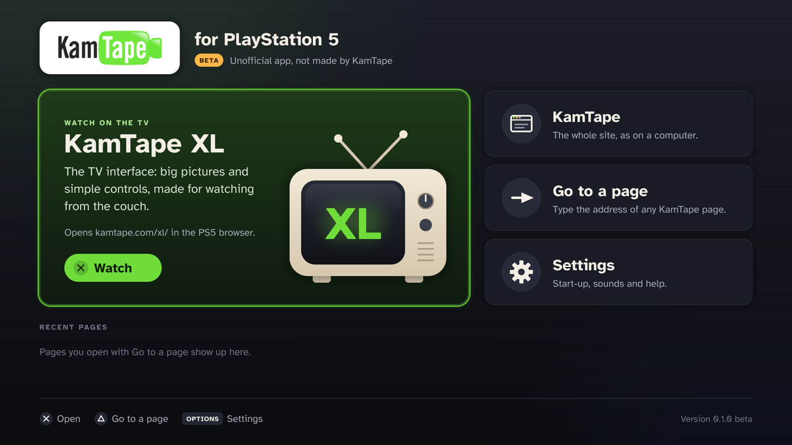
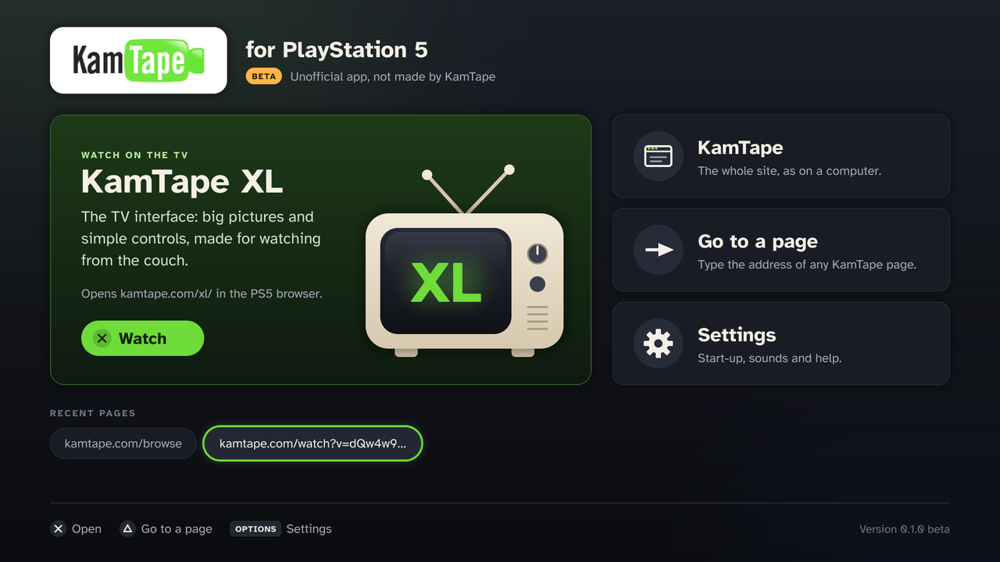
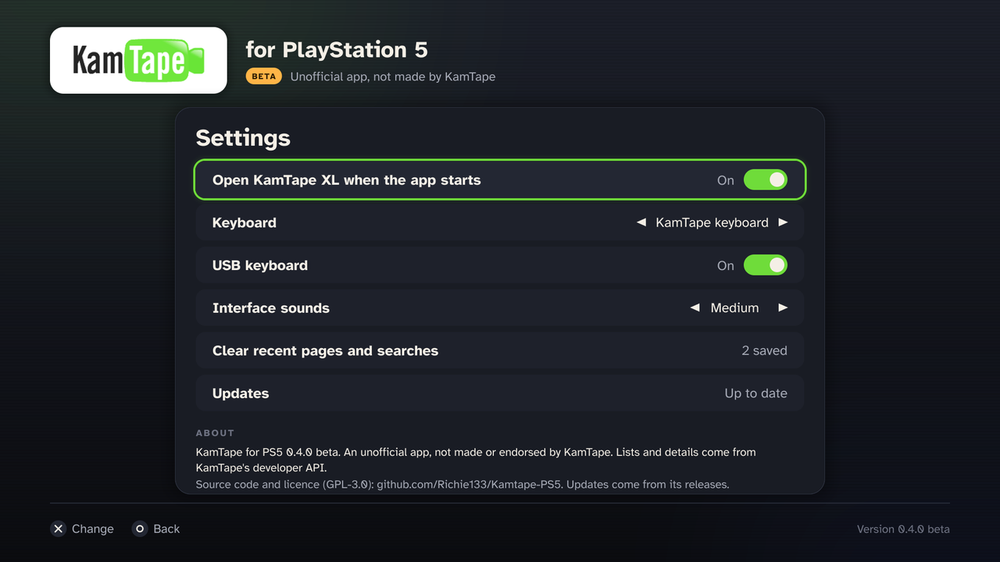

# KamTape for PS5

A native PS5 homebrew app (PPSA52005) for [KamTape](https://www.kamtape.com/), the
retro video site in the style of 2007. It opens **[KamTape XL](https://www.kamtape.com/xl/)**,
KamTape's TV interface, in the PS5's web browser, straight from the home screen.

This is an unofficial app. It is not made or endorsed by KamTape.

> **Status: beta.** It builds into a signed app folder, and the whole app runs on a PC
> (pictures below). **It hasn't been run on a real PS5 yet**, so the first runs on
> hardware may need fixes. Please open an issue if something goes wrong.



## What it does

- **KamTape XL** opens by itself when the app starts (you can turn that off), or with ✕ on the big tile.
- **KamTape** opens the full site, as on a computer.
- **Go to a page** (or △ anywhere) opens the system keyboard. Type any KamTape address,
  such as `kamtape.com/xl/`, `xl/` or a video link, and it opens in the browser. Only
  KamTape pages open here.
- **Recent pages** keeps the last five pages you opened with Go to a page.
- **Settings** (or OPTIONS): open XL at start on or off, interface sound volume, clear
  recent pages.

Close the browser to come back to the app. In the browser, move the pointer with the
left stick and press ✕ to click.





## What you need

- A PS5 that runs homebrew apps (etaHEN, or kstuff with a homebrew launcher such as
  ShadowMountPlus).
- An internet connection.

## Install

1. Unzip `PPSA52005.zip` from the [latest release](https://github.com/Richie133/Kamtape-PS5/releases)
   and copy the `PPSA52005` folder to `/data/homebrew/` on the console (FTP). If you
   use a homebrew store such as ProsperoStore, install it from there instead.
2. Open **KamTape for PS5** from the home screen.

## Controls

| | Controller |
|---|---|
| Move | D-pad or left stick |
| Open | ✕ |
| Go to a page | △ |
| Settings | OPTIONS |
| Back | ○ |

## How it works

The app is a native title (`eboot.bin`, `sce_sys/`) with its own OpenGL interface,
built on the same native-app tooling as
[Flashpoint PS5](https://github.com/Richie133/flashpointps5). Pages open in the PS5's
own web browser (`sceSystemServiceLaunchWebBrowser`), and text comes from the system
keyboard (`libSceImeDialog`). Settings are saved in the title's own storage
(`/download0/kamtape/settings.json`).

## Building

On Linux or WSL with clang-18, lld, Python 3 and ninja:

```sh
make             # dist/PPSA52005/ and dist/PPSA52005.zip
make test        # the PC tests (what Go to a page accepts)
make snapshots   # the app on a PC, pictures in build/snapshots (needs Mesa EGL)
make help        # everything else
```

The first build downloads the pinned [PS5 Payload SDK](https://github.com/ps5-payload-dev/sdk)
and [ps5-opengl](https://github.com/darkxex/ps5-opengl) into `.deps/` and checks their
checksums.

### Releases

Pushing a tag such as `v0.1.0-beta` builds the app on GitHub Actions and publishes
`PPSA52005.zip` on a release for that tag (a pre-release when the tag has `alpha`,
`beta` or `rc` in it), with its sha256 in the notes. Raise `contentVersion` in
`sce_sys/param.json` before every release, so consoles see the update.

## Licence

GPL-3.0-or-later; see `LICENSE` and `THIRD_PARTY_NOTICES.md`. The KamTape name and logo
belong to KamTape.
